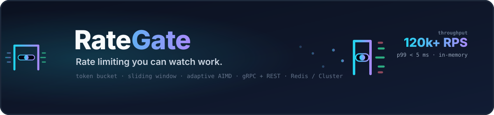
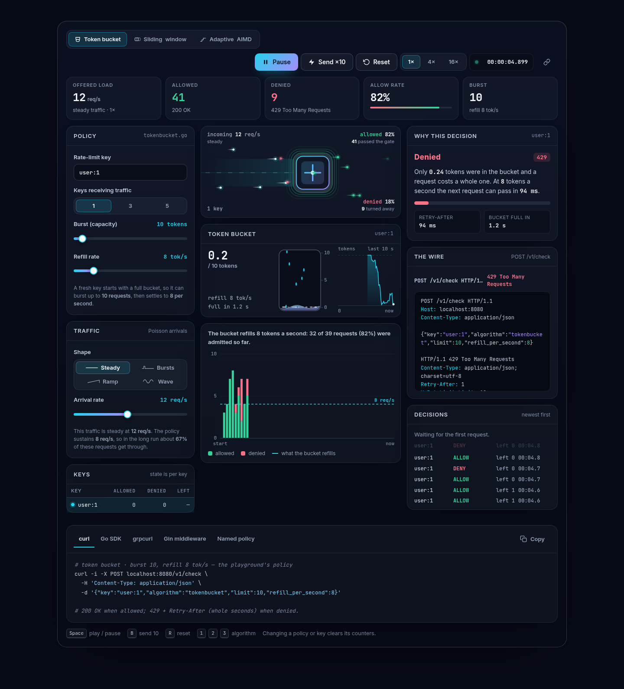
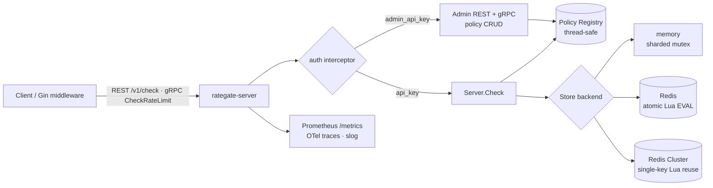

<p align="center">
  
</p>

<p align="center">
  <strong>محدودسازی نرخ، چیزی که میتوانی ببینی کار میکند.</strong><br/>
  یک محدودکنندۀ نرخِ در grad تولید، توزیعشده و به زبان Go — سطل توکن، پنجرۀ لغزان و تطبیقی (AIMD) — روی gRPC و REST، در حافظه یا Redis/Cluster.
</p>

<p align="center">
  <a href="https://github.com/Abolfazlrwm/rategate/actions/workflows/ci.yml"></a>
  <a href="https://goreportcard.com/report/github.com/Abolfazlrwm/rategate"></a>
  <a href="https://codecov.io/gh/Abolfazlrwm/rategate"></a>
  <a href="https://github.com/Abolfazlrwm/rategate/releases"></a>
  
  
  <a href="https://abolfazlrwm.github.io/rategate/"></a>
</p>

<p align="center">
  خواندن به: <a href="README.md">English</a> · <a href="README.fa.md">فارسی</a>
</p>

---

> ▶ **زنده امتحان کن:** [پلیگراند مرورگری](https://abolfazlrwm.github.io/rategate/)
> یک **پورت وفادار** از الگوریتمهای سطل توکن، پنجرۀ لغزان و تطبیقیِ سرور را
> داخل مرورگرت اجرا میکند — یک سیاست را تنظیم کن، بارانی از درخواست بفرست
> و ببین هر درخواست لحظهای پذیرفته میشود یا رد. بدون بکاند، بدون ثبتنام.

<p align="center">
  <a href="https://abolfazlrwm.github.io/rategate/">
    
  </a>
</p>

> **عنوان:** بیش از ۱۲۰هزار RPS روی یک لپتاپ با p99 زیر ۵ میلیثانیه (سطل توکن
> در حافظه). متدولوژی و جدول کامل در [docs/benchmarks.md](docs/benchmarks.md).

## چرا مهم است

هر API عمومی به محدودسازی نرخ نیاز دارد. بیشتر تیمها یک هک `INCR` روی Redis
میبندند که زیر همزمانی رِیس میدهد، یا مالیات یک SaaS میپردازند. RateGate
گزینهی خستهکننده، درست و سریعی است که خودت اجرا میکنی:

- **از پایه درست.** هر دو الگوریتم اتمیک اجرا میشوند — در حافظه با mutex خردشده،
  در Redis با اسکریپت یکپارچۀ `EVAL`. هیچ رِیس read-then-writeای نیست. (نگاه
  به [ADR-0002](docs/adr/0002-redis-lua-scripts.md).)
- **آنقدر سریع که نامرئی است.** مسیر داغ سطل توکن ~۴۰ نانوثانیه/عمل با صفر
  تخصیص است. مسیر کامل REST روی یک لپتاپ بیش از ۱۲۰هزار RPS نگه میدارد.
  بنچمارکها در CI روی هر PR با diffِ `benchstat` اجرا میشوند.
- **درَبَر.** یک middleware برای Gin، یک SDK کلاینت Go (HTTP + gRPC) و یک
  باینری مستقل. شکلی که به deployت میخورد انتخاب کن.
- **قابل مشاهده.** متریکهای Prometheus روی یک رجیستری خصوصی، تریس
  OpenTelemetry (نمونهبرداری ۱۰٪)، لاگ ساختاریافتهی `slog`. `/healthz` و
  `/readyz` برای کوبرنیتیز.
- **سختگیرانه.** پوشش تست ۱۰۰٪ روی `internal/algorithms` و `internal/store`
  (در CI اجباری)، race detector سبز، `golangci-lint` سختگیر، بدون panic
  بازگیرینشده در مسیر درخواست.

## مقایسه

| | هک `INCR` روی Redis | محدودکنندۀ SaaS | کتابخانۀ عمومی Go | **RateGate** |
| --- | :---: | :---: | :---: | :---: |
| خودمیزبان، بدون قفل فروشنده | ✅ | ❌ پولی و میزبانی | ✅ | ✅ |
| بدون Redis کار میکند (در حافظه) | ❌ | — | متفاوت | ✅ |
| اتمیک زیر همزمانی | ❌ رِیس read-then-write | ✅ | متفاوت | ✅ mutex خردشده / Lua `EVAL` |
| تطبیقی (AIMD، آگاه از تقاضا) | ❌ | نادر | ❌ | ✅ |
| سرویس gRPC + REST، نه فقط کتابخانه | ❌ | ✅ | ❌ فقط درونپروسه | ✅ |
| API ادمین در زمان اجرا (بدون ریاستارت) | ❌ | متفاوت | ❌ | ✅ |
| Redis Cluster | دستی | متفاوت | متفاوت | ✅ استفادهی مجدد Lua تککلیدی |
| middleware آماده برای Gin / stdlib | خودت بساز | متفاوت | متفاوت | ✅ |
| مستقل از زبان (هر کلاینتی) | ✅ | ✅ | فقط Go | ✅ gRPC + REST |
| لایسنس | — | تجاری | متفاوت | Apache-2.0 |

> سلولهای گزینههای ثالث عمداً محافظهکارانه («متفاوت») نوشته شدهاند چون هر
> پروژه فرق دارد؛ قبل از تصمیم، مستندات بالادستی را چک کن.

## هایلایتها

- 🚪 **سه الگوریتم واقعی** — سطل توکن، پنجرۀ لغزان (دقیق + تقریبی حلقه) و تطبیقی AIMD، همگی روی نانوثانیههای BigInt با refill تنبل.
- 🧱 **سه ذخیرهگاه** — حافظۀ درونپروسه (mutex خردشده)، Redis تکگره و Redis Cluster، همگی پشت یک قرارداد `Store.Check`.
- 🛰️ **دو انتقال** — gRPC (`CheckRateLimit`) و REST (`/v1/check`)، بهعلاوۀ یک API ادمین thread-safe برای CRUD سیاست در زمان اجرا.
- 🔌 **middleware درَبَر** — `GinMiddleware` و `StdlibMiddleware`، بهعلاوۀ SDK کلایننت Go (HTTP + gRPC).
- 📊 **بهطور پیشفرض قابل مشاهده** — Prometheus `/metrics`، تریس OpenTelemetry، لاگ ساختاریافتهی `slog`، هدرهای `X-RateLimit-*` روی هر پاسخ.
- 🐳 **deploy با یک دستور** — ایمیج distroless چندمعماری GHCR، مانیفست کوبرنیتیز، docker-compose با Redis + Prometheus.
- 🧪 **تاییدشده در CI** — race detector، پوشش ۱۰۰٪ روی بستههای هسته، `golangci-lint` سختگیر، diff `benchstat` روی هر PR.

## معماری در یک نگاه



یک درخواست از REST یا gRPC وارد میشود، از intercepter احراز هویتِ هرمتد عبور
میکند (`api_key` برای `CheckRateLimit`، `admin_api_key` برای API ادمین)،
سیاستش را روی رجیستری thread-safe حل میکند و اتمیک روی ذخیرهگاه انتخابشده
اجرا میشود — حافظۀ mutex خردشده، Redis تکگره یا Redis Cluster — همگی از طریق
قرارداد یکسان `Store.Check`. هر مرحله با متریکهای Prometheus، تریس
OpenTelemetry و لاگهای ساختاریافته مشاهده میشود. طراحی کامل در
[docs/architecture.md](docs/architecture.md).

## اسنپشات بنچمارک

بنچمارک میکرو الگوریتمها (`go test -bench=. ./internal/algorithms/`)، سندباکس
۲ vCPU، Go 1.26.0. جدول کامل + نحوۀ بازتولید در [docs/benchmarks.md](docs/benchmarks.md).

| Benchmark | ns/op | allocs/op | RPS/core |
| --- | ---: | ---: | ---: |
| TokenBucket (single key, contended) | 40 | 0 | ~25M |
| TokenBucket (parallel) | 60 | 0 | ~17M |
| SlidingWindow (parallel, exact) | 176 | 0 | ~5.7M |
| SlidingWindow (parallel, approximate) | 67 | 0 | ~15M |
| **REST end-to-end** (`BenchmarkHTTPServer_CheckParallel`) | **11,546** | 48 | **~87k** |

روی یک لپتاپ ۸هستهای مسیر REST به **بیش از ۱۲۰هزار RPS** با **p99 زیر ۵ms**
برای سطل توکن در حافظه میرسد. اعداد Redis-bound به شبکه بستگی دارند؛ روی
Redis لوکال، همان بار p99 زیر ۵ms نگه میدارد.

## شروع سریع

### گزینۀ A — Docker، ذخیرۀ در حافظه (سریعترین)

```bash
docker run --rm -p 8080:8080 -p 9090:9090 \
  -e RATEGATE_STORE_BACKEND=memory \
  ghcr.io/abolfazlrwm/rategate:latest

curl -s localhost:8080/healthz
curl -s -X POST localhost:8080/v1/check \
  -H 'content-type: application/json' \
  -d '{"key":"user:1","algorithm":"tokenbucket","limit":5,"refill_per_second":1}'
```

### گزینۀ B — باینری مستقل

```bash
git clone https://github.com/Abolfazlrwm/rategate
cd rategate
make build
./bin/rategate-server --store=memory
```

### گزینۀ C — با Redis، از طریق Docker Compose

```bash
docker compose -f deployments/docker/docker-compose.yml up --build
# سرور روی :8080 (REST) و :9090 (gRPC)، Redis روی :6379
curl -s -X POST localhost:8080/v1/check \
  -H 'content-type: application/json' \
  -d '{"key":"user:1","limit_name":"default"}'
```

یک فایل نمونۀ کانفیگ با سیاستهای نامگذاریشده در
[`config.example.yaml`](config.example.yaml) است.

## استفاده بهعنوان middleware برای Gin

```go
import (
    "github.com/gin-gonic/gin"

    rategateclient "github.com/Abolfazlrwm/rategate/pkg/client"
    rategatemw     "github.com/Abolfazlrwm/rategate/pkg/middleware"
)

func main() {
    limiter := rategateclient.NewHTTPClient("http://rategate:8080")

    r := gin.Default()
    r.Use(rategatemw.GinMiddleware(limiter, rategatemw.Options{
        KeyFunc:    func(req *http.Request) string { return "user:" + userID(req) },
        Algorithm:  "tokenbucket",
        Limit:      100,
        Refill:     10,        // ۱۰ توکن/ثانیه، بارست ۱۰۰
        // FailClosed: false    -> اگر rategate پایین باشد، ترافیک را بگذار (پیشفرض)
    }))
    r.GET("/api/...", handler)
    r.Run(":8080")
}
```

پاسخها هدرهای `X-RateLimit-Limit`، `X-RateLimit-Remaining` و
`X-RateLimit-Reset` دارند؛ درخواستهای ردشده `429` با `Retry-After` میگیرند.

برای middleware جین، یک سرور standalone توکار و SDK کلایننت ببین [`examples/`](examples/).

## مشارکت

PR خوشآمد است. اول [`CONTRIBUTING.md`](CONTRIBUTING.md) را بخوان (راهاندازی
توسعه، سبک کامیت، گیت پوشش ۱۰۰٪) و [`CODE_OF_CONDUCT.md`](CODE_OF_CONDUCT.md).
مشکلات امنیتی طبق [`SECURITY.md`](SECURITY.md) بهصورت خصوصی رسیدگی میشوند.
برای سوالهای طراحی و ایدهها از [GitHub Discussions](https://github.com/Abolfazlrwm/rategate/discussions) استفاده کن.

اگر RateGate به کارت میآید، لطفاً به ریپو ⭐ بده — کمک میکند دیگران پیدایش
کنند و نشان میدهد کجا سرمایهگذاری کنیم.

## لایسنس

[Apache-2.0](LICENSE). کپیرایت ۲۰۲۵ Abolfazlrwm و مشارکتکنندگان RateGate.
