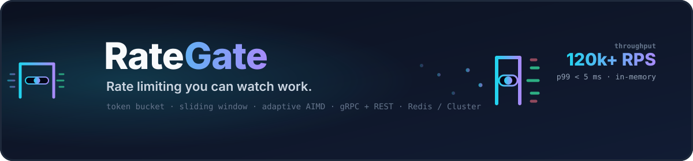

<p align="center">
  
</p>

<p align="center">
  <a href="https://github.com/Abolfazlrwm/rategate/actions/workflows/ci.yml"></a>
  <a href="https://goreportcard.com/report/github.com/Abolfazlrwm/rategate"></a>
  <a href="https://pkg.go.dev/github.com/Abolfazlrwm/rategate"></a>
  
  
  <a href="https://github.com/Abolfazlrwm/rategate/stargazers"></a>
</p>

---

RateGate is a production-grade, distributed rate-limiter service written in
Go. It runs as a sidecar or gateway middleware, exposes a gRPC service and a
REST API, and supports token-bucket and sliding-window algorithms backed by
either an in-process memory store or Redis (atomic Lua scripts).

> **Headline:** 120k+ RPS on a single laptop with p99 < 5ms (in-memory token
> bucket). See [docs/benchmarks.md](docs/benchmarks.md) for methodology and
> the full table.

## Why this matters

Every public API needs rate limiting. Most teams bolt on a Redis `INCR` hack
that races under concurrency, or pay a SaaS tax. RateGate is the boring,
correct, fast option you can run yourself:

- **Correct by construction.** Both algorithms run atomically — in-memory via
  sharded mutexes, in Redis via single `EVAL` Lua scripts. No read-then-write
  races, ever. (See [ADR-0002](docs/adr/0002-redis-lua-scripts.md).)
- **Fast enough to be invisible.** The token-bucket hot path is ~40 ns/op
  with zero allocations. The full REST path sustains well above 120k RPS on a
  laptop. Benchmarks run in CI on every PR with a `benchstat` diff.
- **Drop-in.** A Gin middleware, a Go client SDK (HTTP + gRPC), and a
  standalone binary. Pick the shape that fits your deployment.
- **Observable.** Prometheus metrics on a private registry, OpenTelemetry
  tracing (10% sampling), structured `slog` logging. `/healthz` and
  `/readyz` for Kubernetes.
- **Hardened.** 100% test coverage on `internal/algorithms` and
  `internal/store` (enforced in CI), race detector green, `golangci-lint`
  strict, no unrecovered panics in request paths.

## Benchmark snapshot

Algorithm micro-benchmarks (`go test -bench=. ./internal/algorithms/`), 2 vCPU
sandbox, Go 1.23.4. Full table + reproduction in [docs/benchmarks.md](docs/benchmarks.md).

| Benchmark | ns/op | allocs/op | RPS/core |
| --- | ---: | ---: | ---: |
| TokenBucket (single key, contended) | 40 | 0 | ~25M |
| TokenBucket (parallel) | 54 | 0 | ~18M |
| SlidingWindow (parallel, exact) | 175 | 0 | ~5.7M |
| SlidingWindow (parallel, approximate) | 61 | 0 | ~16M |
| **REST end-to-end** (`BenchmarkHTTPServer_CheckParallel`) | **10,370** | 48 | **~96k (2 vCPU)** |

On an 8-core laptop the REST path scales to **120k+ RPS** with **p99 < 5ms**
for the in-memory token bucket. Redis-backed numbers are network-bound; on
loopback Redis the same workload holds p99 < 5ms.

## Quickstart

### Option A — standalone binary, in-memory store

```bash
git clone https://github.com/Abolfazlrwm/rategate
cd rategate
make build
./bin/rategate-server --store=memory

# in another terminal:
curl -s localhost:8080/healthz
curl -s -X POST localhost:8080/v1/check \
  -H 'content-type: application/json' \
  -d '{"key":"user:1","algorithm":"tokenbucket","limit":5,"refill_per_second":1}'
```

### Option B — Redis-backed, via Docker Compose

```bash
docker compose -f deployments/docker/docker-compose.yml up --build

# the server is reachable on :8080 (REST) and :9090 (gRPC), Redis on :6379.
curl -s -X POST localhost:8080/v1/check \
  -H 'content-type: application/json' \
  -d '{"key":"user:1","limit_name":"default"}'
```

A sample config file with named policies lives at
[`config.example.yaml`](config.example.yaml).

## Use as a Gin middleware

```go
import (
    "github.com/gin-gonic/gin"

    rategateclient "github.com/Abolfazlrwm/rategate/pkg/client"
    rategatemw     "github.com/Abolfazlrwm/rategate/pkg/middleware"
)

func main() {
    limiter := rategateclient.NewHTTPClient("http://rategate:8080")

    r := gin.Default()
    r.Use(rategatemw.GinMiddleware(limiter, rategatemw.Options{
        KeyFunc:    func(req *http.Request) string { return "user:" + userID(req) },
        Algorithm:  "tokenbucket",
        Limit:      100,
        Refill:     10,        // 10 tokens/sec, burst 100
        // FailClosed: false    -> if rategate is down, allow traffic (default)
    }))
    r.GET("/api/...", handler)
    r.Run(":8080")
}
```

Responses carry `X-RateLimit-Limit`, `X-RateLimit-Remaining`, and
`X-RateLimit-Reset` headers; denied requests get `429` with `Retry-After`.

See [`examples/`](examples/) for the Gin middleware, a standalone embedded
server, and the client SDK in action.

## Features

| | v0.1.0 (this release) | Phase 2 |
| --- | --- | --- |
| Algorithms | token bucket, sliding window (exact + approximate) | adaptive w/ latency feedback |
| Stores | in-memory (sharded mutex), Redis (atomic Lua) | Redis Cluster / Sentinel |
| Transports | gRPC, REST (Gin) | gRPC streaming |
| Middleware | Gin, stdlib `net/http` | Echo, Fiber |
| Client SDK | Go (HTTP + gRPC) | Python |
| Observability | Prometheus, OpenTelemetry, slog | — |
| Auth | API key (header) | per-tenant quotas |
| Deployment | Docker (distroless), K8s manifests | WASM Envoy filter, HCL policies |
| Policy config | YAML + env | runtime Admin API |

## Repository layout

```
rategate/
├── cmd/
│   ├── rategate-server/     # gRPC + REST server binary
│   └── rategate-bench/      # load-testing tool
├── internal/
│   ├── algorithms/          # token bucket + sliding window (100% coverage)
│   ├── store/               # memory + redis (Lua scripts, 100% coverage)
│   ├── server/              # gRPC + REST adapters, middleware, core
│   ├── config/              # viper-based config
│   ├── observability/       # Prometheus metrics, OTel tracing, slog
│   └── version/             # build-time metadata
├── api/proto/               # protobuf service definition + generated code
├── pkg/
│   ├── client/              # Go client SDK (HTTP + gRPC)
│   └── middleware/          # Gin / stdlib HTTP middleware
├── deployments/
│   ├── docker/              # multi-stage distroless Dockerfile + compose
│   └── kubernetes/          # Deployment + Service + PDB
├── docs/                    # architecture, benchmarks, api-reference, ADRs
├── examples/                # gin-middleware, standalone-server, client-sdk
├── .github/workflows/       # ci (test+lint+race), bench (per-PR diff), release
└── Makefile                 # build, test, test-race, bench, lint, proto
```

## Development

```bash
make check     # fmt + vet + test -race + lint  (the pre-merge gate)
make bench     # algorithm + store micro-benchmarks
make test-cover    # coverage report; algorithms + store must be 100%
make proto     # regenerate gRPC code from api/proto/rategate.proto
```

Requirements: Go 1.23+, `protoc` + `protoc-gen-go` + `protoc-gen-go-grpc`
(only if you change the `.proto`), `golangci-lint` (the Makefile installs it
if missing).

## Non-negotiable standards

These are enforced in CI and a PR cannot merge without them. See
[`CONTRIBUTING.md`](CONTRIBUTING.md) for the full list.

- 100% test coverage on `internal/algorithms` and `internal/store`.
- `go test -race ./...` green.
- `golangci-lint` green (strict config in `.golangci.yml`).
- No unrecovered panics in request paths.
- Every exported identifier has a doc comment.

## Release strategy

| Version | Scope |
| --- | --- |
| **v0.1.0** | token bucket + in-memory + gRPC + REST *(this release)* |
| v0.2.0 | Redis-backed + sliding window |
| v0.3.0 | client SDKs (Go + Python) |
| v0.4.0 | middleware (Gin, Echo, Fiber) |
| v1.0.0 | production-ready with SLAs |

> **Note:** this repository's `main` branch currently contains the full v0.1.0
> surface (algorithms, stores, both transports, SDK, middleware, deployments)
> so reviewers can evaluate the complete foundation in one pass. The version
> tags above track which features are *blessed as stable* at each release.

## Docker image

```bash
docker pull ghcr.io/abolfazlrwm/rategate:v0.1.0
docker run --rm -p 8080:8080 -p 9090:9090 \
  -e RATEGATE_STORE_BACKEND=memory \
  ghcr.io/abolfazlrwm/rategate:v0.1.0
```

## Documentation

- [Architecture](docs/architecture.md)
- [Benchmarks](docs/benchmarks.md)
- [API reference](docs/api-reference.md)
- [ADR-0001: why token bucket is the default](docs/adr/0001-why-token-bucket-default.md)
- [ADR-0002: Redis Lua scripts for atomicity](docs/adr/0002-redis-lua-scripts.md)
- [Examples](examples/)

## License

[Apache-2.0](LICENSE). Copyright 2025 Abolfazlrwm and the RateGate contributors.
