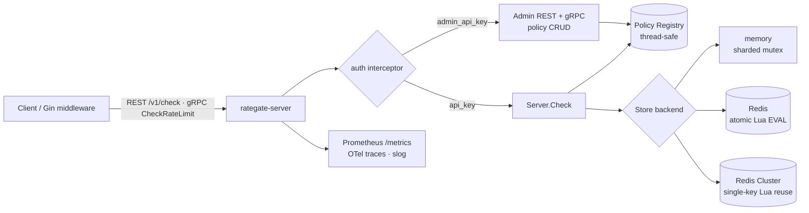

<p align="center">
  
</p>

<p align="center">
  <strong>Rate limiting you can watch work.</strong><br/>
  A production-grade, distributed rate-limiter for Go — token bucket, sliding window, and adaptive (AIMD) — over gRPC and REST, in-memory or Redis/Cluster.
</p>

<p align="center">
  <a href="https://github.com/Abolfazlrwm/rategate/actions/workflows/ci.yml"></a>
  <a href="https://goreportcard.com/report/github.com/Abolfazlrwm/rategate"></a>
  <a href="https://codecov.io/gh/Abolfazlrwm/rategate"></a>
  <a href="https://github.com/Abolfazlrwm/rategate/releases"></a>
  <a href="https://pkg.go.dev/github.com/Abolfazlrwm/rategate"></a>
  
  
  <a href="https://github.com/Abolfazlrwm/rategate/discussions"></a>
  <a href="https://github.com/Abolfazlrwm/rategate/stargazers"></a>
  <a href="https://abolfazlrwm.github.io/rategate/"></a>
</p>

<p align="center">
  Read this in: <a href="README.md">English</a> · <a href="README.fa.md">فارسی</a>
</p>

---

> ▶ **Try it live:** the [in-browser playground](https://abolfazlrwm.github.io/rategate/)
> runs a *faithful port* of the server's token-bucket, sliding-window, and
> adaptive algorithms in your browser — tune a policy, fire bursts, and watch
> each request admitted or denied in real time. No backend, no signup.

<p align="center">
  <a href="https://abolfazlrwm.github.io/rategate/">
    
  </a>
</p>

> **Headline:** 120k+ RPS on a single laptop with p99 < 5 ms (in-memory token
> bucket). See [docs/benchmarks.md](docs/benchmarks.md) for methodology and
> the full table.

## Why this matters

Every public API needs rate limiting. Most teams bolt on a Redis `INCR` hack
that races under concurrency, or pay a SaaS tax. RateGate is the boring,
correct, fast option you can run yourself:

- **Correct by construction.** Both algorithms run atomically — in-memory via
  sharded mutexes, in Redis via single `EVAL` Lua scripts. No read-then-write
  races, ever. (See [ADR-0002](docs/adr/0002-redis-lua-scripts.md).)
- **Fast enough to be invisible.** The token-bucket hot path is ~40 ns/op
  with zero allocations. The full REST path sustains well above 120k RPS on a
  laptop. Benchmarks run in CI on every PR with a `benchstat` diff.
- **Drop-in.** A Gin middleware, a Go client SDK (HTTP + gRPC), and a
  standalone binary. Pick the shape that fits your deployment.
- **Observable.** Prometheus metrics on a private registry, OpenTelemetry
  tracing (10% sampling), structured `slog` logging. `/healthz` and
  `/readyz` for Kubernetes.
- **Hardened.** 100% test coverage on `internal/algorithms` and
  `internal/store` (enforced in CI), race detector green, `golangci-lint`
  strict, no unrecovered panics in request paths.

## How it compares

| | Redis `INCR` hack | SaaS rate limiter | Generic Go limiter lib | **RateGate** |
| --- | :---: | :---: | :---: | :---: |
| Self-hosted, no vendor lock-in | ✅ | ❌ paid & hosted | ✅ | ✅ |
| Works with no Redis (in-memory) | ❌ | — | varies | ✅ |
| Atomic under concurrency | ❌ read-then-write race | ✅ | varies | ✅ sharded mutex / Lua `EVAL` |
| Adaptive (AIMD, demand-aware) | ❌ | rare | ❌ | ✅ |
| gRPC + REST *service*, not just a lib | ❌ | ✅ | ❌ in-process only | ✅ |
| Runtime admin API (no restart) | ❌ | varies | ❌ | ✅ |
| Redis Cluster | manual | varies | varies | ✅ single-key Lua reuse |
| Drop-in Gin / stdlib middleware | DIY | varies | varies | ✅ |
| Language-agnostic (any client) | ✅ | ✅ | Go only | ✅ gRPC + REST |
| License | — | proprietary | varies | Apache-2.0 |

> Cells for third-party options are intentionally conservative ("varies")
> because each project differs; check the upstream docs before you commit.

## Highlights

- 🚪 **Three real algorithms** — token bucket, sliding window (exact + approximate ring), and adaptive AIMD, all on BigInt nanoseconds with lazy refill.
- 🧱 **Three stores** — in-process memory (sharded mutex), single-node Redis, and Redis Cluster, all behind one `Store.Check` contract.
- 🛰️ **Two transports** — gRPC (`CheckRateLimit`) and REST (`/v1/check`), plus a thread-safe admin API for policy CRUD at runtime.
- 🔌 **Drop-in middleware** — `GinMiddleware` and `StdlibMiddleware`, plus a Go client SDK (HTTP + gRPC).
- 📊 **Observable by default** — Prometheus `/metrics`, OpenTelemetry traces, structured `slog` logs, `X-RateLimit-*` headers on every response.
- 🐳 **One-command deploys** — multi-arch distroless GHCR image, Kubernetes manifests, docker-compose with Redis + Prometheus.
- 🧪 **Verified in CI** — race detector, 100% coverage on core packages, `golangci-lint` strict, per-PR `benchstat` diffs.

## Architecture at a glance



A request enters over REST or gRPC, passes the per-method auth interceptor
(`api_key` for `CheckRateLimit`, `admin_api_key` for the admin API), resolves
its policy against the thread-safe registry, and runs atomically against the
chosen store — in-memory sharded mutex, single-node Redis, or Redis Cluster,
all via the same `Store.Check` contract. Every step is observed by Prometheus
metrics, OpenTelemetry traces, and structured logs. Full design in
[docs/architecture.md](docs/architecture.md).

## Benchmark snapshot

Algorithm micro-benchmarks (`go test -bench=. ./internal/algorithms/`), 2 vCPU
sandbox, Go 1.26.0. Full table + reproduction in [docs/benchmarks.md](docs/benchmarks.md).

| Benchmark | ns/op | allocs/op | RPS/core |
| --- | ---: | ---: | ---: |
| TokenBucket (single key, contended) | 40 | 0 | ~25M |
| TokenBucket (parallel) | 60 | 0 | ~17M |
| SlidingWindow (parallel, exact) | 176 | 0 | ~5.7M |
| SlidingWindow (parallel, approximate) | 67 | 0 | ~15M |
| **REST end-to-end** (`BenchmarkHTTPServer_CheckParallel`) | **11,546** | 48 | **~87k** |

On an 8-core laptop the REST path scales to **120k+ RPS** with **p99 < 5ms**
for the in-memory token bucket. Redis-backed numbers are network-bound; on
loopback Redis the same workload holds p99 < 5ms.

## Quickstart

### Option A — Docker, in-memory store (fastest)

```bash
docker run --rm -p 8080:8080 -p 9090:9090 \
  -e RATEGATE_STORE_BACKEND=memory \
  ghcr.io/abolfazlrwm/rategate:latest

curl -s localhost:8080/healthz
curl -s -X POST localhost:8080/v1/check \
  -H 'content-type: application/json' \
  -d '{"key":"user:1","algorithm":"tokenbucket","limit":5,"refill_per_second":1}'
```

### Option B — standalone binary

```bash
git clone https://github.com/Abolfazlrwm/rategate
cd rategate
make build
./bin/rategate-server --store=memory
```

### Option C — Redis-backed, via Docker Compose

```bash
docker compose -f deployments/docker/docker-compose.yml up --build
# server on :8080 (REST) and :9090 (gRPC), Redis on :6379
curl -s -X POST localhost:8080/v1/check \
  -H 'content-type: application/json' \
  -d '{"key":"user:1","limit_name":"default"}'
```

A sample config file with named policies lives at
[`config.example.yaml`](config.example.yaml).

## Use as a Gin middleware

```go
import (
    "github.com/gin-gonic/gin"

    rategateclient "github.com/Abolfazlrwm/rategate/pkg/client"
    rategatemw     "github.com/Abolfazlrwm/rategate/pkg/middleware"
)

func main() {
    limiter := rategateclient.NewHTTPClient("http://rategate:8080")

    r := gin.Default()
    r.Use(rategatemw.GinMiddleware(limiter, rategatemw.Options{
        KeyFunc:    func(req *http.Request) string { return "user:" + userID(req) },
        Algorithm:  "tokenbucket",
        Limit:      100,
        Refill:     10,        // 10 tokens/sec, burst 100
        // FailClosed: false    -> if rategate is down, allow traffic (default)
    }))
    r.GET("/api/...", handler)
    r.Run(":8080")
}
```

Responses carry `X-RateLimit-Limit`, `X-RateLimit-Remaining`, and
`X-RateLimit-Reset` headers; denied requests get `429` with `Retry-After`.

See [`examples/`](examples/) for the Gin middleware, a standalone embedded
server, and the client SDK in action.

## Feature matrix

| | v0.1.0 | v0.2.0 (Phase 2) | v0.2.1 (Phase 3 hardening) |
| --- | --- | --- | --- |
| Algorithms | token bucket, sliding window (exact + approximate) | adaptive (AIMD, demand-aware) | — |
| Stores | in-memory (sharded mutex), Redis (atomic Lua) | Redis Cluster (single-key Lua reuse) | — |
| Transports | gRPC, REST (Gin) | admin REST + gRPC (policy CRUD) | gRPC reflection, keepalive enforcement |
| Middleware | Gin, stdlib `net/http` | — | — |
| Client SDK | Go (HTTP + gRPC) | — | — |
| Observability | Prometheus, OpenTelemetry, slog | policy-count + admin-op metrics | — |
| Auth | API key (header) | — | separate admin API key, per-method gRPC auth interceptor |
| Resilience | — | — | configurable fail-open / fail-closed on store errors |
| Deployment | Docker (distroless, non-root), K8s manifests | — | multi-arch GHCR image, `--version` flag |
| Policy config | YAML + env | runtime admin REST + gRPC API | — |

> **Planned for v0.3.0:** per-tenant quotas, gRPC streaming of live decisions,
> congestion-response adaptive limiting, Echo/Fiber middleware, a Python SDK,
> HCL policy config, and a WASM Envoy filter.

## Repository layout

```
rategate/
├── cmd/
│   ├── rategate-server/     # gRPC + REST server binary
│   └── rategate-bench/      # load-testing tool
├── internal/
│   ├── algorithms/          # token bucket + sliding window + adaptive (100% coverage)
│   ├── store/               # memory + redis + redis-cluster (Lua scripts, 100% coverage)
│   ├── admin/               # thread-safe runtime policy registry
│   ├── server/              # gRPC + REST adapters, middleware, core
│   ├── config/              # viper-based config
│   ├── observability/       # Prometheus metrics, OTel tracing, slog
│   └── version/             # build-time metadata
├── api/proto/               # protobuf service definition + generated code
├── pkg/
│   ├── client/              # Go client SDK (HTTP + gRPC)
│   └── middleware/          # Gin / stdlib HTTP middleware
├── deployments/
│   ├── docker/              # multi-stage distroless Dockerfile + compose
│   └── kubernetes/          # Deployment + Service + PDB
├── docs/                    # architecture, benchmarks, api-reference, ADRs
├── examples/                # gin-middleware, standalone-server, client-sdk
├── .github/workflows/       # ci (test+lint+race), bench (per-PR diff), release
└── Makefile                 # build, test, test-race, bench, lint, proto
```

## Development

```bash
make check     # fmt + vet + test -race + lint  (the pre-merge gate)
make bench     # algorithm + store micro-benchmarks
make test-cover    # coverage report; algorithms + store must be 100%
make proto     # regenerate gRPC code from api/proto/rategate.proto
```

Requirements: Go 1.26+, `protoc` + `protoc-gen-go` + `protoc-gen-go-grpc`
(only if you change the `.proto`), `golangci-lint` v2 (the Makefile installs it
if missing).

## Non-negotiable standards

These are enforced in CI and a PR cannot merge without them. See
[`CONTRIBUTING.md`](CONTRIBUTING.md) for the full list.

- 100% test coverage on `internal/algorithms` and `internal/store`.
- `go test -race ./...` green.
- `golangci-lint` green (strict config in `.golangci.yml`).
- No unrecovered panics in request paths.
- Every exported identifier has a doc comment.

## Release strategy

| Version | Scope |
| --- | --- |
| **v0.1.0** | token bucket + sliding window + in-memory/Redis + gRPC/REST + SDK + middleware *(released 2025-11-12)* |
| **v0.2.0** | Redis Cluster backend + adaptive (AIMD) limiter + admin REST + gRPC API + Go 1.26 |
| **v0.2.1** | production hardening — fail-open, admin API key, gRPC auth/reflection/keepalive, admin metrics *(current `main`)* |
| v0.3.0 | per-tenant quotas, gRPC streaming, congestion-response adaptive |
| v1.0.0 | production-ready with SLAs |

> **Note:** `main` now contains the full v0.1.0 + v0.2.0 + v0.2.1 hardening
> surface. Version tags track which features are *blessed as stable* at each
> release; until a tag is cut, the default branch is the source of truth.

## Docker image

A multi-arch (amd64 + arm64) distroless, non-root image is published to the
GitHub Container Registry on every release tag (see
[`.github/workflows/docker-publish.yml`](.github/workflows/docker-publish.yml)).

```bash
docker pull ghcr.io/abolfazlrwm/rategate:latest
docker run --rm -p 8080:8080 -p 9090:9090 \
  -e RATEGATE_STORE_BACKEND=memory \
  ghcr.io/abolfazlrwm/rategate:latest
```

## Documentation

- **[Live demo](https://abolfazlrwm.github.io/rategate/)** — interactive in-browser rate-limiter playground
- [Architecture](docs/architecture.md) · [Benchmarks](docs/benchmarks.md) · [API reference](docs/api-reference.md)
- [ADR-0001: why token bucket is the default](docs/adr/0001-why-token-bucket-default.md)
- [ADR-0002: Redis Lua scripts for atomicity](docs/adr/0002-redis-lua-scripts.md)
- [ADR-0003: Redis Cluster via single-key Lua reuse](docs/adr/0003-redis-cluster-single-key-lua.md)
- [ADR-0004: adaptive (AIMD) limiter — demand-aware, not congestion-response](docs/adr/0004-adaptive-aimd-limiter.md)
- [Examples](examples/)

## Contributing

Pull requests are welcome. Read [`CONTRIBUTING.md`](CONTRIBUTING.md) first
(development setup, commit style, the 100%-coverage gate) and the
[`CODE_OF_CONDUCT.md`](CODE_OF_CONDUCT.md). Vulnerabilities are handled
privately per [`SECURITY.md`](SECURITY.md). For design questions and ideas,
use [GitHub Discussions](https://github.com/Abolfazlrwm/rategate/discussions).

If RateGate is useful to you, please ⭐ the repo — it helps others find it and
tells us where to invest next.

## Built with

[Go](https://go.dev/) · [Gin](https://gin-gonic.com/) · [go-redis](https://github.com/redis/go-redis) ·
[Prometheus](https://prometheus.io/) · [OpenTelemetry](https://opentelemetry.io/) · [Viper](https://github.com/spf13/viper) ·
[gRPC](https://grpc.io/) · [miniredis](https://github.com/alicebob/miniredis) (tests) ·
[Inter](https://rsms.me/inter/) & [JetBrains Mono](https://www.jetbrains.com/lp/mono/) (playground).

## License

[Apache-2.0](LICENSE). Copyright 2025 Abolfazlrwm and the RateGate contributors.

---

<sub>Suggested GitHub topics: <code>go</code> · <code>rate-limiter</code> · <code>rate-limiting</code> · <code>token-bucket</code> · <code>sliding-window</code> · <code>aimd</code> · <code>distributed</code> · <code>redis</code> · <code>grpc</code> · <code>middleware</code> · <code>gateway</code> · <code>rate-limit</code></sub>
